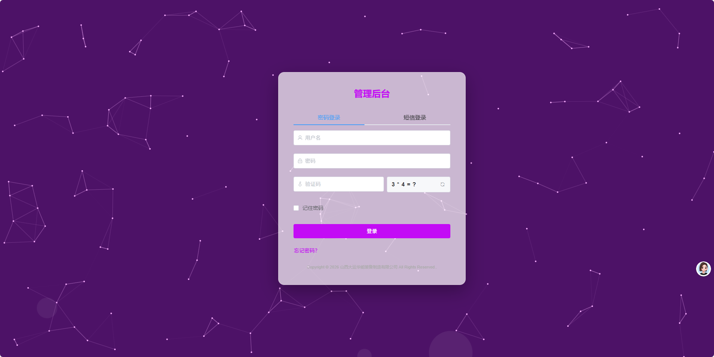
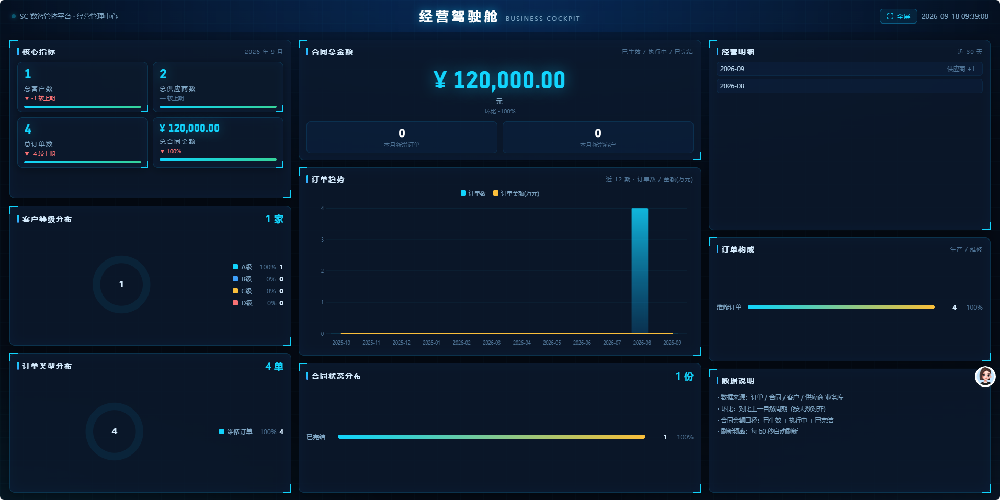
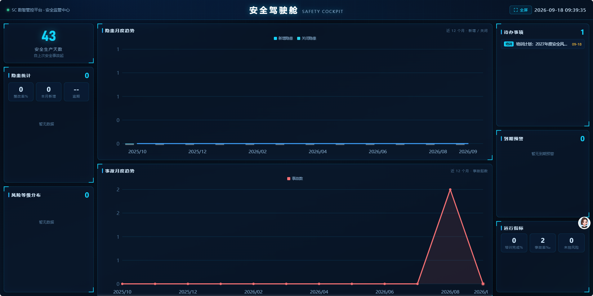
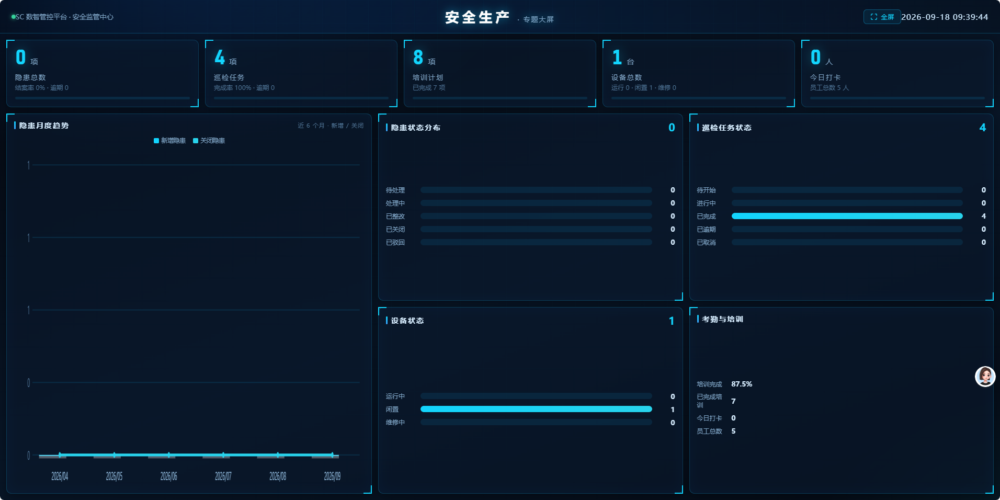
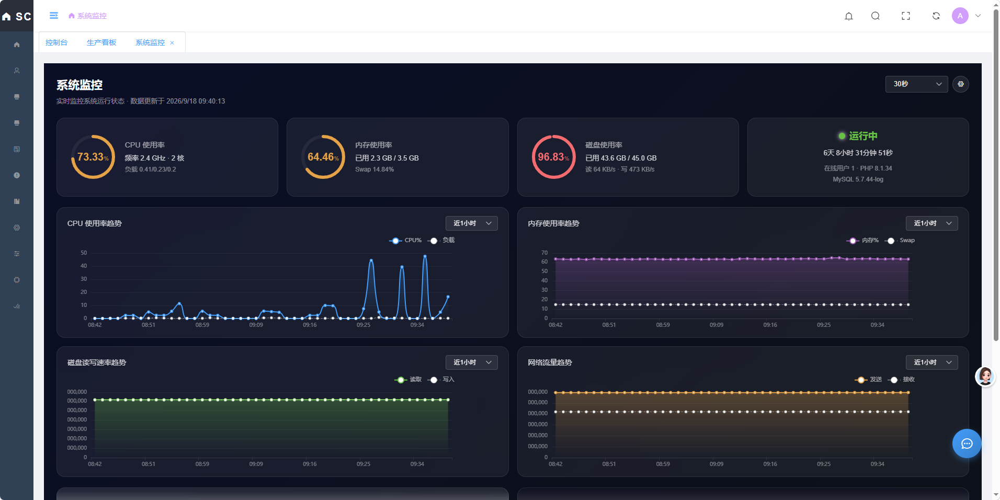

<div align="center">

# 数智管控平台（SC Admin）

**开源 ERP / MES / OA 一体化企业管理系统** · 制造装备行业 · v19.0.0

</div>

<div align="center">

<a href='https://gitee.com/li-yao11111/sc-admin/stargazers'>
  </img>
</a>
<a href="https://img.shields.io/badge/版本-v19.0.0-blue">
  
</a>
<a href="https://img.shields.io/badge/试用-30天-orange">
  
</a>
<a href="https://img.shields.io/badge/授权-绑定域名-green">
  
</a>

</div>

<div align="center">

[在线体验](http://test-install.yywyrh.cn/admin/) | [移动端 H5](http://test-install.yywyrh.cn/h5/) | [提交反馈](https://gitee.com/li-yao11111/sc-admin/issues)

</div>

<div align="center">

🖥 **在线体验（含演示数据）**：后台 http://test-install.yywyrh.cn/admin/ ｜ 移动端 http://test-install.yywyrh.cn/h5/
👤 **演示账号（只读）**：demo ／ admin123　※ 仅可查看数据，无新增 / 编辑 / 删除等操作权限

</div>

---

### 📝 项目介绍

**平台定位**

面向制造 / 装备企业的**开源企业管理系统（ERP/MES/OA 一体化）**，覆盖**人事、考勤薪酬、经营 CRM、采购销售、进销存仓储、生产制造、质量管理、安全管理、设备管理、财务管理、统一审批、企业网盘**等全业务场景，配套**移动端 H5** 与**数据驾驶舱大屏**，一套系统打通企业管理全链路。

**关键词**：企业管理系统、ERP、MES、生产制造、进销存、仓储管理、质量管理、安全管理、设备管理、OA 审批、移动办公、ThinkPHP、Vue、开源系统

**技术架构**

采用 **ThinkPHP 8 + Vue 2.7 + UniApp** 技术栈，前后端分离设计；后台 Web 端 + 移动端 H5 双端数据实时联动，支持部署于宝塔面板 / 云服务器 / 物理机。

**核心亮点**

- **数据驾驶舱**：经营驾驶舱、安全驾驶舱、安全生产大屏、系统监控四大看板，深色科技风设计，支持全屏投屏（会议室 / LED 大屏）
- **全场景覆盖**：后台管理、移动办公、审批流转、实时消息、扫码出入库、质量追溯一应俱全
- **开箱即用**：内置安装向导，自动建库、自动导入数据、自动生成环境配置，10 分钟完成部署
- **授权灵活**：30 天试用 → 授权码激活，授权码与绑定域名一一对应，换域名需重新授权

---

### 🧩 功能特性

#### 管理后台（Web 端）

| 模块 | 主要功能 |
|---|---|
| **首页控制台** | 待办提醒、快捷入口、关键经营数据一览 |
| **组织人事** | 组织架构、员工档案、员工异动；考勤（班次/排班/打卡记录/人脸打卡/打卡点配置/假勤申请/考勤统计）；薪酬（工分汇总/工资计算/薪酬标准表/补助标准/工资条生成查询/薪酬统计）；绩效考核（考核模板/考核任务/考核看板/申诉处理）；招聘（招聘需求/职位管理/简历管理/录用管理/招聘统计） |
| **经营管理** | 客户档案与分类；CRM（销售线索/商机漏斗/商机列表）；供应商档案/考核评级/分类/黑名单；产品/BOM/图纸管理；订单（订单列表/订单评审/报价单）；合同（合同列表/到期提醒/模板管理）；采购（采购申请/采购订单/订单跟踪/到货记录/询比价/采购统计）；销售（出库单/发货管理/物流跟踪/销售额分析/客户排行/产品排行）；产品接收与运输管理；项目管理；预算管理 |
| **资产管理** | 个人资产（我的/部门/全部资产）、资产领用申请、资产调拨、可借用资产、消耗记录与统计、资产退还、固定资产（资产档案/折旧/盘点/处置）、资产报表（个人/部门/调拨统计/成本核算） |
| **财务中心** | 记账凭证、会计科目、总账/明细账、财务报表、账龄分析、费用报销、付款计划、采购对账 |
| **仓储物流** | 仓库/货位/物料/物料分类设置；配件出入库（采购入库/领用/退库/报废/入库统计）；设备出入库（产品接收/入库/出库）；库存管理（库存查询/库存流水/库存预警/库存分析/补货建议）；批次管理、扫码出入库、库存盘点（计划/执行/差异） |
| **生产制造** | 工艺路线/工序/工位管理；MRP 物料需求计划、生产工单、生产排程；工单派工、报工记录/审核、生产进度；质量管理（质检标准/检验任务/不合格品处理/质量统计/质量追溯）；生产看板；成本核算；生产异常呼叫（Andon）；ECN 变更 |
| **设备管理** | 设备分类、设备台账、状态变更、设备巡检；设备保养（计划/任务/记录/统计）；设备维修（工单/记录/统计）；设备提醒；OEE 分析 |
| **安全管理** | 隐患管理（登记/列表/整改/验证任务）；安全检查（计划/任务/记录）；安全培训（计划/记录/档案/证书管理/考试题库/试卷/成绩）；事故管理（登记/调查/统计）；风险管控（辨识/评估/管控措施）；安全驾驶舱、安全生产大屏 |
| **统一审批** | 我的待办、我发起的、审批历史、审批流程配置、审批代理设置、审批统计、常用语管理（所有业务统一走审批流） |
| **企业网盘** | 文件/文件夹管理、按部门/员工授权、密码文件夹、回收站、本地/COS 存储 |
| **数据驾驶舱** | 经营驾驶舱、安全驾驶舱、安全生产大屏（LED 投屏）、系统监控，支持全屏展示与自动刷新 |
| **AI 智能平台** | 对话中心（新建对话/历史/收藏）、模型配置、工具中心（工具列表/分类/审批/调用日志）、知识库（文档上传/数据源/检索测试）、智能体中心（列表/评测/发布）、工作流编排（创建/运行日志）、应用中心（API 密钥管理）、运营中心（用量统计/监控告警/操作审计）、智能报告、销售预测、客户智能（价值分析/流失预警）、自然语言交互 |
| **系统设置** | 用户/角色/权限管理、菜单管理、数据字典、系统参数、基础服务（存储/短信/邮件/微信/电子签/物流/人脸识别/钉钉/U8 对接）、消息通知（消息列表/模板/设置/发送记录）、公告管理、协议管理、界面配置、登录页设置、移动端应用配置（路径/功能/DIY 页面编辑/底部导航）、安全策略、FIDO2 硬件密钥安全策略 |
| **系统维护** | 系统日志、授权管理（试用/授权码/域名绑定）、系统监控（CPU/内存/磁盘/网络实时趋势）、系统更新、数据库维护、健康检查、消息推送、BI 报表 |

#### 移动端（H5）

| 模块 | 主要功能 |
|---|---|
| **首页** | 快捷功能入口（最多 7 项 + 更多功能聚合页）、公告中心、待办提醒、DIY 自定义页面 |
| **通讯录 / 消息** | 组织架构、员工资料（头像/部门/联系方式）、实时聊天：文字/图片/文件/表情，本地缓存优先（消息不占用服务器存储）、消息列表显示双方头像、点击头像查看资料 |
| **工作台** | 考勤打卡（定位/人脸打卡）、工资查询、审批发起、费用报销、我的证书、考勤统计、隐患上报、安全巡检 |
| **安全模块** | 隐患上报/整改查看、巡检任务执行、安全培训与考试、证书查询、安全驾驶舱（移动端） |
| **我的** | 个人资料与头像（支持上传）、账号设置（修改密码/手机号/协议同意）、消息设置、帮助与反馈、关于我们、系统设置 |
| **更多设置** | 全部功能菜单聚合入口、夜间模式、清理缓存、版本信息、用户协议与隐私政策 |

#### 特色能力

- **多端一体**：后台（PC）+ 移动端（H5）共用一套数据，手机扫码即用
- **统一审批**：报销、合同、采购、调拨、假勤等所有业务统一走审批流，后台/移动端同步处理
- **数据大屏**：经营驾驶舱 / 安全驾驶舱 / 安全生产大屏 / 系统监控，深色科技风、60 秒自动刷新、支持全屏投屏
- **AI 赋能**：对话问答、智能体（审批助手/催办/订单处理）、知识库、智能报告、销售预测、客户流失预警
- **扫码应用**：扫码出入库、扫码盘点，移动端即扫即用
- **安全体系**：RBAC 权限（菜单/按钮级）、登录验证码、JWT 鉴权、FIDO2 硬件密钥、操作日志、授权域名绑定
- **扩展对接**：可对接 U8、钉钉、微信、短信、邮件、电子签、物流、人脸识别等外部服务

---

### 🖥 系统界面展示

**后台登录页**



**经营驾驶舱**（经营管理 · 数据大屏）



**安全驾驶舱**（安全管理 · 深色科技大屏）



**安全生产专题大屏**（LED 大屏展示）



**系统监控**（服务器运行状态实时监控）



---

### ⚙️ 技术特点

- **权限管理**：RBAC 角色权限模型，可精细控制到每个菜单/按钮
- **统一审批**：所有业务（报销、合同、采购、调拨等）走统一审批流，移动端/后台同步处理
- **安全体系**：操作日志、登录验证码、JWT 鉴权、数据安全存储、授权域名绑定
- **实时消息**：通讯录实时聊天（文字/图片/文件/表情），本地缓存优先，消息不占用服务器存储
- **大屏能力**：多套数据大屏（经营/安全/生产/监控），深色科技风，60 秒自动刷新
- **扩展友好**：代码分层清晰、注释齐全，支持二次开发与模块扩展
- **多端适配**：后台（PC）+ 移动端（H5）同一套数据，手机扫码即用

---

### 🚀 部署安装

#### 一、环境要求

| 组件 | 要求 | 说明 |
|---|---|---|
| 操作系统 | CentOS 7+ / Ubuntu 18+ / 宝塔面板均可 | 已适配宝塔多版本 PHP |
| Web 服务器 | Nginx（推荐）或 Apache | 站点 root 指向 `public/` |
| PHP | **8.1.x（务必 8.1）** | 运行扩展与 PHP 8.1 版本绑定 |
| MySQL | 5.7+ / 8.0（utf8mb4） | 安装向导自动建库 |
| Redis | 任意版本（含密码） | 缓存/验证码依赖 |

#### 二、PHP 扩展清单（安装向导会自动检测）

必须开启以下扩展，缺一不可：

| 扩展 | 用途 |
|---|---|
| **beast**（随包提供的运行扩展） | 核心依赖，见下方安装 |
| pdo_mysql | 数据库连接 |
| mbstring | 中文/多字节处理 |
| openssl | 签名校验、HTTPS |
| json | 接口数据 |
| curl | 授权平台验证、外部请求 |
| gd | 图片处理（验证码/头像/图片上传） |
| fileinfo | 文件类型识别 |
| zip | 压缩/导出 |
| bcmath | 高精度计算（财务/成本） |
| intl | 国际化/字符处理 |
| redis | 缓存（验证码、权限、会话） |
| xml / SimpleXML | 导入导出 |

> 宝塔面板：软件商店 → PHP 8.1 → 安装扩展，勾选以上全部即可（beast 按下文单独装）。

#### 三、PHP 配置项（php.ini）建议

| 配置项 | 建议值 | 说明 |
|---|---|---|
| `memory_limit` | ≥ **256M**（建议 512M） | 安装向导硬性检测，低于 256M 会拦截 |
| `file_uploads` | On | 文件上传 |
| `allow_url_fopen` | On | 授权回调/远程请求 |
| `post_max_size` / `upload_max_filesize` | ≥ 50M | 附件/凭证上传 |
| `max_execution_time` | ≥ 300（CLI 不限） | 导入大 SQL、报表导出 |
| `date.timezone` | Asia/Shanghai | 避免时间偏差 |

##### ⚠️ 禁用函数（disable_functions）注意事项

系统 PHP 层**不依赖** `exec` / `shell_exec` / `proc_open` 等命令执行函数，但仍请**不要禁用以下函数**，否则授权验证、文件上传、安装向导会失败：

**严禁禁用：**
- `curl_exec`（授权平台验证、远程请求）
- `file_get_contents` / `file_put_contents`（授权回调、写缓存）
- `copy` / `unlink` / `rename` / `mkdir` / `rmdir` / `chmod`（文件操作、热更新）
- `password_hash` / `password_verify`（登录）
- `random_bytes`（JWT/密钥生成）
- `session_start` / `json_encode` / `json_decode`

**可以禁用（不影响运行）：**
- `shell_exec` / `exec` / `system` / `passthru` / `proc_open` / `popen` / `pcntl_exec` 等命令执行类
- 若使用宝塔默认安全配置（已禁用 putenv/proc_open 等），无需调整，系统可正常运行。

#### 四、安装步骤

**1. 解压部署**

将仓库内容上传至站点目录（如 `/www/wwwroot/your-site`），**保留完整目录结构**：

```bash
cd /www/wwwroot
# 方式一：git 克隆（需安装 git）
git clone https://gitee.com/li-yao11111/sc-admin.git your-site
# 方式二：下载压缩包解压
unzip sc-admin.zip -d your-site
cd your-site
```

**2. 设置目录权限**

```bash
chmod -R 777 config runtime public storage database
chown -R www:www /www/wwwroot/your-site   # 宝塔默认运行用户为 www
```

> 安装向导会检测 `config / runtime / public / storage / database` 五个目录可写，权限不足会拦截。

**3. 创建数据库**

- 新建空数据库，编码选 **utf8mb4 / utf8mb4_unicode_ci**
- 数据库账号需对库有 **ALL（增删改查建表）** 权限
- 数据库名/账号/密码稍后在安装向导中填写（向导也支持自动建库）

**4. 安装运行扩展（核心）**

```bash
cd /www/wwwroot/your-site
bash install.sh
```

脚本会自动：定位 PHP 8.1 扩展目录 → 复制运行扩展 → 写入 `php.ini` 启用 → 提示重启 PHP-FPM。

**完成后务必重启 PHP-FPM**：
- 宝塔：软件商店 → PHP 8.1 → 服务 → 重启
- 命令行：`systemctl restart php-fpm`（或宝塔对应命令）

> ⚠️ **重要**：`beast.so` 与 PHP 版本严格绑定（当前为 PHP 8.1 编译）。若服务器 PHP 不是 8.1，请先切换/安装 PHP 8.1 再运行本脚本；否则安装后系统无法正常运行。

**5. 配置 Nginx**

站点 root 指向 `public/`，并配置 ThinkPHP 伪静态：

```nginx
server {
    listen 80;
    server_name your-domain.com;
    root /www/wwwroot/your-site/public;   # ← 必须指向 public/
    index index.php index.html;

    # 伪静态（重要：否则除首页外全部 404）
    location / {
        if (!-e $request_filename) {
            rewrite ^(.*)$ /index.php?s=$1 last;
        }
    }

    location ~ \.php(.*)$ {
        fastcgi_pass unix:/tmp/php-cgi-81.sock;  # 宝塔：对应 PHP 8.1 的 sock
        fastcgi_index index.php;
        fastcgi_param SCRIPT_FILENAME $document_root$fastcgi_script_name;
        include fastcgi_params;
    }

    location ~* \.(jpg|jpeg|png|gif|ico|css|js|woff2?|ttf|svg|mp4)$ {
        expires 30d;
        access_log off;
    }

    client_max_body_size 50m;   # 上传大小
}
```

- 宝塔面板：站点 → 设置 → 配置文件，粘贴上述 server 块（root 与伪静态为关键）
- Apache 环境：开启 `mod_rewrite`，将 `.htaccess`（public/ 下已内置）启用即可

配置完成后 `nginx -t` 测试并 reload。

**6. 运行安装向导**

浏览器访问：**http://你的域名/install**

按四步完成：
1. **环境检测**：PHP 版本、全部扩展、目录权限、PHP 配置逐项检测，全绿才可继续
2. **数据库配置**：填写数据库主机/端口/库名/账号/密码 + **Redis 密码**（与服务器 Redis 一致）
3. **管理员账号**：设置后台管理员用户名/密码/邮箱
4. **执行安装**：自动导入数据表（约 1.2 万条语句 + 增量迁移）→ 生成 `.env`（含随机 JWT 密钥）→ 创建管理员 → 写入安装锁

安装完成自动跳转后台登录页（`/admin`）。

**7. 启动全部定时任务**

系统内置多个定时任务，统一由 `schedule.php` 一个入口调度（含：系统监控数据采集、安全告警检查、订单扫描、用户流失预警、远程代码同步等）。执行一次即自动注册计划任务并全部生效：

```bash
cd /www/wwwroot/your-site
php schedule.php   # 自动写入 crontab（每分钟触发），内部按各任务频率统一调度
```

验证是否成功：`crontab -l | grep schedule.php` 能看到 `* * * * * ... schedule.php` 即为正常。

> 若服务器环境无法自动写 crontab（如已禁用 exec），可手动添加计划任务：
> `* * * * * php /www/wwwroot/your-site/schedule.php > /dev/null 2>&1`
>
> ⚠️ 不配置此任务：系统监控趋势图无数据、告警检查/订单扫描/远程同步等后台任务不执行（不影响正常业务操作，建议务必配置）。

**8. 授权（试用 → 正式）**

- 首次访问后台自动进入 **30 天试用**，自动绑定当前域名
- 试用满意后：前往授权平台（aa.yywyrh.cn）购买授权码，在后台「系统维护 → 授权管理」输入授权码，或在 `.env` 配置：
  ```ini
  AA_VERIFY_URL = https://aa.yywyrh.cn/api/v1/verify
  AA_PROJECT_CODE = SC_ADMIN
  AA_LICENSE_KEY = SC_ADMIN-XXXXXXXX
  ```
- **授权码与首次绑定的域名一一对应**，更换域名需重新购买
- 试用到期未授权将限制登录，输入有效授权码即恢复

---

### ❓ 常见问题

| 现象 | 原因与解决 |
|---|---|
| 安装向导提示扩展未开启 | 按扩展清单在宝塔开启对应扩展后刷新 |
| 提示目录不可写 | `chmod -R 777 config runtime public storage database` |
| 安装后页面空白/500 | 运行扩展未生效：确认 PHP 为 8.1、`php -m | grep beast` 有输出、已重启 PHP-FPM |
| 除首页外全 404 | Nginx 未配置伪静态（见安装步骤 5） |
| 验证码不显示 | Redis 扩展/密码配置错误，检查 `.env` 的 REDIS_PASSWORD |
| 授权验证失败 | 确认服务器可访问外网（curl 扩展已开），检查授权码与域名 |

---

### 📁 目录结构

```
├── app/            # 应用代码（PHP）
├── config/         # 配置（安装向导生成 install.lock）
├── database/       # 数据库脚本与增量迁移
├── public/         # Web 根目录（nginx root 指向此）
├── resources/      # 视图/模板
├── route/          # 路由
└── vendor/         # 依赖（已内置，无需 composer install）
```

> 其余扩展组件、初始化脚本、部署说明等均随包内置，按上方安装步骤使用即可。`.env` 由安装向导生成随机密钥，无需手动配置。详细部署说明见 `DEPLOY.txt`。

---

### 📮 联系我们

- **Gitee 仓库**：https://gitee.com/li-yao11111/sc-admin
- **在线体验**：http://test-install.yywyrh.cn/admin/（只读演示账号 demo / admin123）｜ 移动端：http://test-install.yywyrh.cn/h5/
- **提交反馈 / 问题**：https://gitee.com/li-yao11111/sc-admin/issues

如果本项目对你有帮助，欢迎右上角 Star ⭐ 支持一下！
